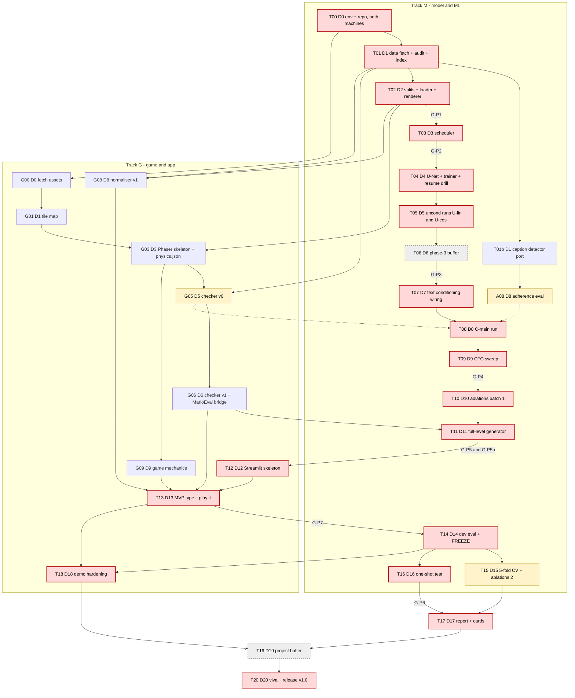

# 04 — Critical Path, Dependencies, Slack and Buffers

> **Authority:** `00_DECISIONS_LEDGER.md` §10 (21 days, Day 0–20) and `03_TIMELINE_DAY_BY_DAY.md` (what happens each day). This document says **which tasks gate which**, **where the slack is**, **which GPU jobs can run in parallel on the two machines**, **how buffers are spent**, and **what gets cut first**. Day slots are written D0…D20. "DT" = desktop RTX 3060 Ti, "LT" = laptop RTX 4050 (H1).

---

## 1. Task inventory

Durations are in **day slots** (one slot = one working day of ~5–7 focused hours) or hours for short G-track tasks. "GPU" = wall-clock that runs unattended. IDs are used throughout this doc and in `scripts/status.py`.

| ID | Task | Track | Slot | Duration (hands-on) | GPU wall-clock | Hard predecessors | Gate produced |
|---|---|---|---|---|---|---|---|
| T00 | Environment + repo scaffold on both machines | B | D0 | 1 slot (~6 h) | — | — | Phase 0 (`verify_env` green) |
| G00 | Autonomous asset fetch (Phaser, Kenney) | G | D0 | 1.5 h | — | T00 | — |
| T01 | Data fetch, audit (F1–F17), chain index, EDA | M | D1 | ~4.5 h | — | T00 | — |
| T01b | Caption detector port (100 % fidelity) | M | D1 | ~1.5 h | — | T01 | — |
| G01 | Kenney tile-map contact sheet → `assets/tile_map.json` | G | D1 | 1 h | — | G00 | — |
| T02 | Splits + LOCK, P-casual set, dataset, renderer | M | D2 | 1 slot (~7 h) | — | T01 | **G-P1** |
| T03 | Scheduler + property tests | M | D3 | ~5 h | — | T02 (G-P1) | **G-P2** |
| G03 | Phaser skeleton + `physics.json` | G | D3 | ~3 h | — | T02 (renderer JSON), G01 | — |
| T04 | U-Net, trainer core, overfit test, hw_report, resume drill | M | D4 | 1 slot (~7 h) | ~0.5 h | T03 (G-P2), T02 | — |
| T05 | Unconditional runs U-lin ‖ U-cos + structure eval | M | D5 | ~4 h | 🌙 DT ‖ LT | T04 | **G-P3** |
| G05 | Playability checker v0 + real-level baseline | G | D5 | ~4 h | — (CPU) | G03, T01 | — |
| T06 | **Phase-3 buffer** (rollback) — else checker v1 | M/G | D6 | ≤ 1 slot | optional | T05 | (G-P3 re-gate) |
| G06 | Checker v1 + MarioEval.jar bridge | G | D6 | ~4 h | — (CPU/Java) | G05 | — |
| T07 | Text conditioning wiring + tests + 3k smoke | M | D7 | ~6 h | ~0.3 h | **G-P3 pass**, T06 | — |
| A08 | Adherence eval (C-score + exact match) | M | D8 | ~2 h | — | T01b | — |
| T08 | C-main conditional run (≤ 60k steps, early stop) | M | D8 | ~3 h | 🌙 DT | T07, A08*, G05* | — |
| G08 | Prompt normaliser v1 | G | D8 | ~4 h | — | T01, T02 (P-casual) | — |
| T09 | Checkpoint selection, CFG sweep, contrast test | M | D9 | ~5 h | ~1 h (shardable) | T08, A08 | **G-P4** |
| G09 | Game mechanics (enemies, blocks, flag, HUD) | G | D9 | ~4 h | — | G03 | — |
| T10 | Ablation batch 1 (X1–X4) → config v1 | M | D10 | ~4 h | 🌙 DT ‖ LT | T09 (G-P4) | — |
| T11 | Full-level generator + seam metric | M | D11 | 1 slot (~7 h) | ~1 h | T10, G06 | **G-P5, G-P5b** |
| T12 | Streamlit studio skeleton | G | D12 | 1 slot (~7 h) | — | T11 (G-P5) | — |
| T13 | "Type it, play it" MVP integration + E2E smoke | G | D13 | 1 slot (~7 h) | — | T12, G09, G08, G06 | **G-P7** |
| T14 | Full dev evaluation + **FREEZE** | M | D14 | ~6 h | ~1.5 h (shardable) | T13 (policy†), T11 | — |
| T15 | 5-fold grouped CV + ablation batch 2 | M | D15 | ~3 h | 🌙 DT ‖ LT | T14 | — |
| T16 | **One-shot test evaluation** | M | D16 | ~4 h | ~1 h (single machine) | T14 | **G-P6** |
| T17 | Report figures, model card, data card | B | D17 | 1 slot (~7 h) | — | T15, T16 | — |
| T18 | Demo hardening (offline, CPU, showcase, browsers) | G | D18 | ~6 h | — | T13, T14 | (G-P7 re-check) |
| T19 | **Project buffer** | B | D19 | 1 slot | — | — | — |
| T20 | Viva rehearsal + release v1.0 | B | D20 | 1 slot | — | T17, T18, T19 | Release checklist |

\* **Soft predecessors of T08.** The dev composite (E4) needs A08 (C-score) and G05 (playability term). If either is not ready at launch time, start T08 with the in-loop dev evaluation disabled. Checkpoints are still saved every 2k steps, and `scripts/eval_dev.py --watch runs/<id>` scores them as they appear (or afterwards). Early stopping is then applied post hoc on the same E4 score, so nothing is lost but wall-clock.
† **Policy edge** (doc 03 phase map): the freeze happens only after the MVP exists, so that the demo and the reported numbers come from the same frozen checkpoint.

## 2. Dependency graph

Red = critical path. Grey dashed = buffers. Edge labels name the gate whose `reports/gates/PN/RESULT.json` must contain `"pass": true` before the successor may start (CLAUDE.md §3).



## 3. Critical path

```
T00 → T01 → T02 ─G-P1→ T03 ─G-P2→ T04 → T05 → [T06 buffer] ─G-P3→ T07 → T08 → T09 ─G-P4→ T10 → T11 ─G-P5/5b→ T12 → T13 ─G-P7→ T14 → T16 ─G-P6→ T17 → T18* → [T19 buffer] → T20
```

- **Length:** 21 slots, of which **T19 (1 slot)** and **about half of T06** are explicit buffer. That is the "1.5 days of explicit buffer" stated in `01_PDF_AUDIT.md` §D. T06 is only partly buffer: if G-P3 passes first time, T06 does planned checker v1 work (G06), which itself has 4 slots of slack (§4). So in the good case T06's buffer value moves to the G track.
- \* **T17 and T18** have no dependency on each other. With **one operator** they are sequential (resource-levelled), so both are critical. With **two people** (doc 03 §Two-person mapping), T18 can run in parallel on D17 and T18 gains 1 slot of slack.
- **Why the critical path runs through T12–T13 (G track):** the freeze (T14) waits for the MVP (policy edge †). Slipping the app therefore delays the final numbers. This is intentional: it forces the app onto the frozen checkpoint, and it is why app work starts early on the G track (D3, D5, D6, D8, D9).

### 3.1 Gate edges (hard stops)

| Edge | Gate file that must say `pass: true` | Consequence of a failed gate |
|---|---|---|
| T02 → T03 | `reports/gates/P1/RESULT.json` | Fix data or render bug; never start the scheduler on unverified data |
| T03 → T04 | `reports/gates/P2/RESULT.json` | Fix scheduler maths before any training |
| T05/T06 → T07 | `reports/gates/P3/RESULT.json` | Rollback per doc 25 R-3.x; T06 absorbs one retrain |
| T09 → T10 | `reports/gates/P4/RESULT.json` | Rollback per doc 25 R-4.x; consumes T19 if beyond 0.5 slot |
| T11 → T12 | `reports/gates/P5/RESULT.json`, `reports/gates/P5b/RESULT.json` | Escalation ladder doc 25 R-5.x |
| T13 → T14 | `reports/gates/P7/RESULT.json` | Fix latency or embedding before freezing |
| T16 → T17 | `reports/gates/P6/RESULT.json` | Only a metric-code bug may justify a documented re-run (doc 03 D16) |

## 4. Slack per task

Slack = how many slots a task can slip without moving the critical path. "Constraining successor" is what sets its latest finish.

| Task | Scheduled | Latest finish | Slack | Constraining successor | Note |
|---|---|---|---|---|---|
| G00 assets | D0 | end D2 | **2** | G03 (latest start ≈ D3) | Fallback A2 placeholder sprites removes the dependency entirely |
| G01 tile map | D1 | end D2 | **1–2** | G03 | Can be done in the same session as G03 |
| T01b detector | D1 | end D7 | **~5** | A08 (D8) | First thing to defer if D1 overruns. Doc 03's D1 exit then becomes "detector ≥ 99.5 % by end of D7" (record the deferral in `PROGRESS.md`) |
| EDA write-up (part of T01) | D1 | end D16 | **large** | T17 report | Figures must come from scripts; prose can wait |
| G03 Phaser skeleton | D3 | end D4 | **~1** | G05 (latest start D7) via G05's own slack | `physics.json` is the actual dependency; the visual polish has more slack |
| G05 checker v0 | D5 | end D7 | **2** | T08 (E4 playability term) | **Near-critical.** If late, use the T08 soft-dependency rule (§1 \*) |
| G06 checker v1 + bridge | D6 | end D10 | **4** | T11 (G-P5b) | Absorbs T06 if T06 becomes a rollback day |
| A08 adherence | D8 | D8 morning (in-loop) / end D8 (watch mode) | **0–1** | T08 / T09 | **Near-critical.** Write it first on D8, before launching T08 |
| G08 normaliser | D8 | end D12 | **4** | T13 | T09's contrast test may use hand-canonicalised strings if G08 is late |
| G09 game mechanics | D9 | end D12 | **3** | T13 | D12 is busy with T12 on the same laptop → effective slack ≈ 2.5 |
| T15 CV + ablations 2 | D15 | end D16 (night) | **1** | T17 | GPU-only overnight work. Can overlap with T16 because the test run takes ~1 h |
| T18 hardening | D18 | end D18 | 0 (1 operator) / 1 (2 people) | T20 via T19 | — |
| All other T-tasks | — | — | **0** | — | Critical |

## 5. Parallelisable GPU jobs (both machines busy at the right times)

Every job satisfies the min-VRAM contract (H2–H4), so any job can run on either machine. The table is the default allocation; doc 07 covers moving a job mid-flight.

| Slot | DT (3060 Ti) | LT (4050) | Notes |
|---|---|---|---|
| D4 | Resume drill part 1 (1,000 steps); then the identical-config 3k cross-machine check (doc 07 §9.3) | `hw_report` at batch 64 (200 steps); drill part 2 (500 steps); identical-config 3k check | Both machines' `hw_report.json` feed §5.1 |
| D5 🌙 | **U-lin** 15k steps + evals at 5k/10k/15k | **U-cos** 15k steps + evals | Independent; the gate compares them |
| D6 | (only if rollback) retrain the winning schedule | Checker v1 (CPU) | Rollback retrains on whichever machine is free first |
| D7 | — | Conditional smoke 3k steps | DT is free: MAY run a second smoke seed |
| D8 🌙 | **C-main** (≤ 60k, early stop) | MAY: C-main seed-1 replicate (variance estimate for the report) | LT CPU is used for G08 at the same time; a GPU run does not block CPU work |
| D9 | CFG sweep shard A (w ∈ {1, 2, 3}) | CFG sweep shard B (w ∈ {5, 7.5, 10}) | Eval jobs shard by w or by prompt subset; results merged by `scripts/sweep_cfg.py --merge` |
| D10 🌙 | X1 (aux CE), X3 (pooled text) | X2 (EMA 0.995), X4 (balanced sampling, conditional) | 40k-step budget each, same seeds |
| D11 | Full-level eval for G-P5 | MarioEval.jar agreement (Java, CPU) | — |
| D14 | Dev eval shard A (P-dev) | Dev eval shard B (P-rand, P-casual-dev) | Merge with `scripts/eval_dev.py --merge` |
| D15 🌙 | CV folds 1–3, then ablation batch 2 | CV folds 4–5 | Fold allocation is re-balanced from measured speed (§5.1, doc 07 §12) |
| D16 | **One-shot test on the FROZEN machine only** | CV leftovers if any | Test numbers come from one machine and one environment, recorded in `FROZEN.json` (doc 07 §11) |

### 5.1 Planning estimates for GPU wall-clock (replace on Day 4)

These are **assumptions**, to be replaced by the measured `it/s` in `runs/<id>/hw_report.json` on Day 4. `scripts/status.py` recomputes the table from the measured values.

| Quantity | Planning assumption | Basis |
|---|---|---|
| Training speed, batch 64, bf16 | DT ≈ 15 it/s, LT ≈ 9 it/s | 18.3 M-parameter U-Net at 16×16 (H8); about 3 GFLOP per sample per training step (forward + backward); small spatial sizes keep utilisation low |
| One dev evaluation (≈ 120 prompts × 3 seeds, DDIM 50, CFG) | 1–2 min | 100 batched forward passes + CPU checker + GPU NN search |
| U run, 15k steps + 3 evals | DT ≈ 20–25 min, LT ≈ 30–40 min | — |
| C-main, 60k steps + 30 evals | DT ≈ 1.6–2.2 h | Early stopping usually ends it sooner |
| Ablation, 40k steps + 20 evals | DT ≈ 1.1–1.5 h, LT ≈ 1.6–2.2 h | Two per machine fit in one night |
| CV fold (step budget from the frozen run, ≈ 40k) | DT ≈ 1.2 h, LT ≈ 1.8 h | 3 + 2 folds ≈ 3.6 h per machine |

Formula used by `scripts/status.py`: `wallclock = steps / it_s + n_evals × t_eval + n_ckpt × t_ckpt`, with `t_ckpt ≈ 3 s`.

## 6. Buffer policy

### 6.1 Buffers that exist
| Buffer | Size | Type | Protects |
|---|---|---|---|
| T06 (D6) | ≤ 1 slot (≈ 0.5 effective) | Feeding buffer | The riskiest phase: first unconditional training (G-P3) |
| T19 (D19) | 1 slot | Project buffer | Everything before the release |
| Overnight GPU windows 🌙 | ~6–10 h per night vs ~2 h planned | Implicit | GPU runs that need a restart or rollback retrain |
| G-track slack | 2–4 slots (§4) | Implicit | App and checker work |
| Daily hands-on margin | ~1 h per day (days planned at 5–7 h) | Implicit | Small overruns |

### 6.2 Buffer-consumption rule (fever chart)

Every morning, `scripts/status.py` computes:

- `chain_done` = completed critical non-buffer tasks / **18** (T00–T05, T07–T14, T16, T17, T18, T20).
- `buffer_used` = buffer slots consumed / **1.5**.

| Zone | Condition | Action |
|---|---|---|
| 🟢 Green | `buffer_used ≤ chain_done` | Proceed as planned |
| 🟡 Yellow | `chain_done < buffer_used ≤ chain_done + 0.33` | Plan recovery: pull G-track work forward, use evening GPU time, pre-decide the next cut |
| 🔴 Red | `buffer_used > chain_done + 0.33` | Execute the next item in the cut list (§7) **the same day**; note it in `PROGRESS.md` and the requirement change log (doc 02 §12) |

### 6.3 Slip handling
1. Overrun ≤ 0.5 slot on a critical task → absorb in the daily margin plus overnight GPU time. Do not touch buffers.
2. Overrun > 0.5 slot → consume buffer (T06 if before D7; otherwise T19), record it, recompute the zone.
3. A failed gate is never "absorbed" by skipping it. The rollback (doc 25) is the work that consumes buffer.
4. GPU idle rule: **never leave a GPU idle overnight while the critical path has GPU work queued.** Before ending a session, queue the next job (`scripts/queue.py`) on each free machine.

## 7. What to cut first (pre-agreed order)

Cut from the top. Each cut has a recorded consequence for the report. This order matches doc 03's compressed variant and the ledger.

| Order | Cut | Saves | Report consequence |
|---|---|---|---|
| C1 | Ablation batch 2 (X5–X7, D15) | ~1 night GPU, ~1 h hands-on | Fewer ablation rows; state "not run" |
| C2 | Ablation batch 1 reduced to X1 + X2, then X1 only | 1 night GPU | Fewer design-choice justifications |
| C3 | MarioEval.jar agreement → 50 hand-labelled levels (allowed by G-P5b) | ~0.5 slot | Checker validated against human labels instead of the paper's agent |
| C4 | Denoising animation polish (FR-A-10, SHOULD) → static 5-frame strip | ~2 h | UX only |
| C5 | Showcase reduced to 6 levels; Firefox check dropped | ~1 h | UX only |
| C6 | 5-fold CV → seed variance only (3 sampling seeds of the frozen model) | ~1 night GPU + 1 h | Must state in the report that cross-level variance was not estimated (doc 03 compressed) |
| C7 | Dual schedule in Phase 3 → cosine only (only valid **before** D5 starts) | ~0.3 slot | M2 choice by prior, not by measurement; state it |
| C8 | Extended report figures (keep the core set listed in doc 32) | ~0.5 slot | Thinner appendix |

**Never cut** (ledger D3, D4, G5, S2; doc 03): the level-grouped split; `LOCK` and one-shot test discipline; the playability checker and verified badge; the MVP browser game; gates G-P1…G-P7; EMA-only evaluation; reproducibility manifests (doc 30).

## 8. Daily critical-path check (5 minutes, every morning)

Run `python scripts/status.py`. It prints the answers below; the operator confirms them in `PROGRESS.md`.

- [ ] **Today's critical task** (from §1) and its gate.
- [ ] **Predecessor gates** — all `RESULT.json` files on the path up to today say `pass: true`.
- [ ] **In-flight runs** (parsed from `HANDOFF.md`): owner machine, step, ETA from the measured it/s, last heartbeat age (> 30 min with status RUNNING → investigate).
- [ ] **Buffer zone** (§6.2): green / yellow / red. If red → apply the next cut today.
- [ ] **Tonight's GPU plan**: the job queued on DT and on LT (§5). No idle GPU while critical GPU work exists.
- [ ] **Near-critical watch**: G05 (by D7), A08 (by D8 morning), T15 (by D16 night).
- [ ] **Top risk today** (from `33_RISK_REGISTER.md`) and its trigger status.

### 8.1 `scripts/status.py` contract
```text
usage: python scripts/status.py [--day N] [--json]
reads:   docs/04 task table (embedded copy in scripts/status_tasks.yaml), reports/gates/*/RESULT.json,
         HANDOFF.md state block, runs/*/hw_report.json, runs/*/metrics.csv, PROGRESS.md (buffer log)
prints:  today's critical task, gate statuses, run ETAs, fever-chart zone, GPU idle warnings
exit:    0 = green/yellow, 2 = red zone (so a wrapper can alert), 1 = error
```
`scripts/status_tasks.yaml` mirrors §1 (ID, slot, predecessors, gate). It is the only machine-readable copy; when §1 changes, update both in the same commit.

## 9. Mapping to the PDF's 16-day milestones

| PDF milestone | PDF days | This plan | Difference |
|---|---|---|---|
| M1: renderer, text encoder, dataset, scheduler | 1–3 | D1–D3 (+ D0 env) | Text encoder moved to D7 (after G-P3, as the PDF's own phase rule requires) |
| M2: U-Net, train.py, 50-epoch baseline | 4–7 | D4–D6 | Budget in steps (M12); two schedules; resume drill added |
| M3: normaliser, outpainting, conditional training, CFG sweep | 8–12 | D7–D11 | Ablations and playability gate added |
| M4: web UI, Phase-6 evaluation | 13–16 | D12–D16 | App before freeze; CV and one-shot test added |
| — | — | D17–D20 | Report, hardening, buffer, viva (not in the PDF) |
