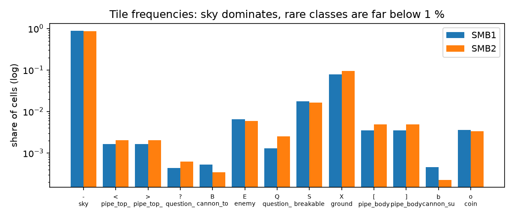
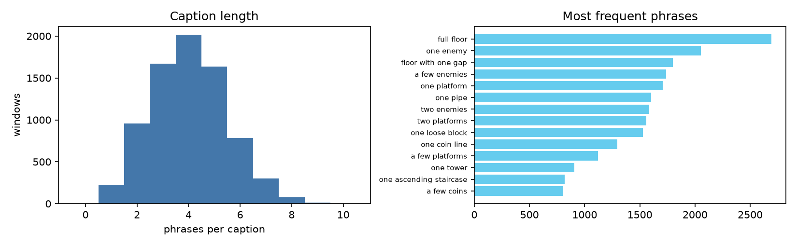
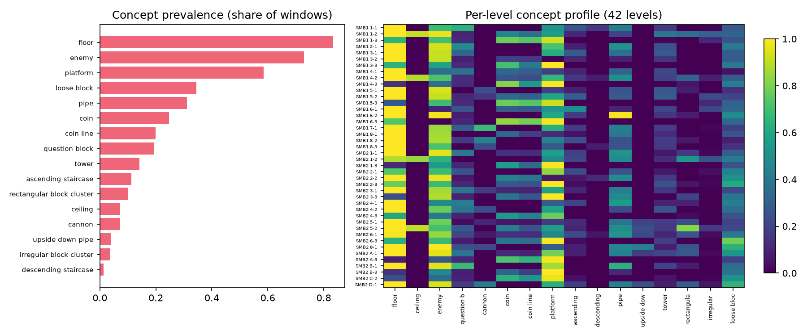

# Exploratory data analysis (generated by scripts/eda.py)

- **7,687 windows** of 16x16 cells over 13 tile classes from **42 levels** (SMB1 20, SMB2 22).
- **Class imbalance:** sky is 87.1 % of all cells; ground 8.7 %; every other class is below 3 % (coins 0.34 %, cannon tops 0.04 %). This is why per-bucket loss and rare-concept metrics are reported.
- **Captions:** 2,668 distinct captions, 62 distinct phrases, mean 4.03 phrases per caption (max 10), 0 empty.
- **Concept prevalence** (share of windows): floor 83.4 %, enemy 72.9 %, platform 58.5 %, loose block 34.5 %, pipe 31.1 %, coin 24.7 %, coin line 20.0 %, question block 19.3 %, ...
- **Levels differ:** the heat map shows strong per-level profiles (sky levels vs underground levels), which is why the split is by level and why held-out levels are a real test of generalisation.

